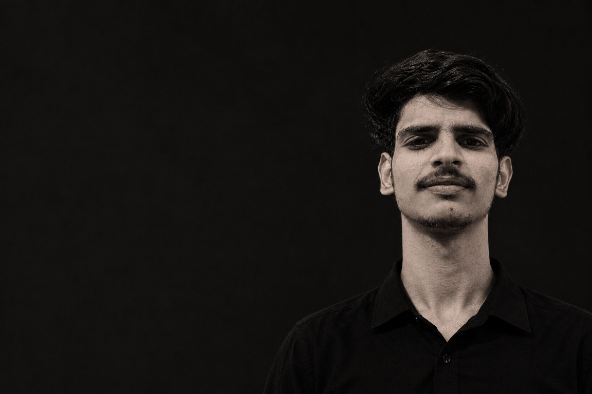
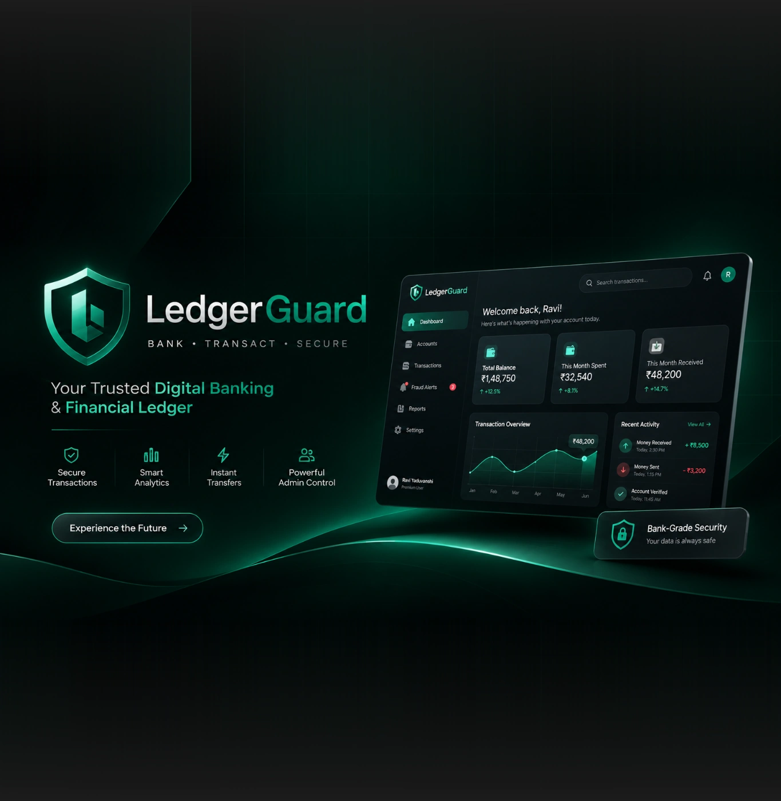
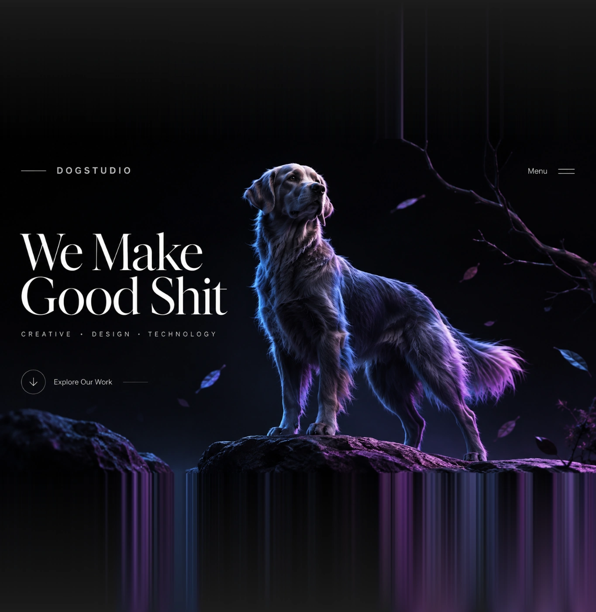
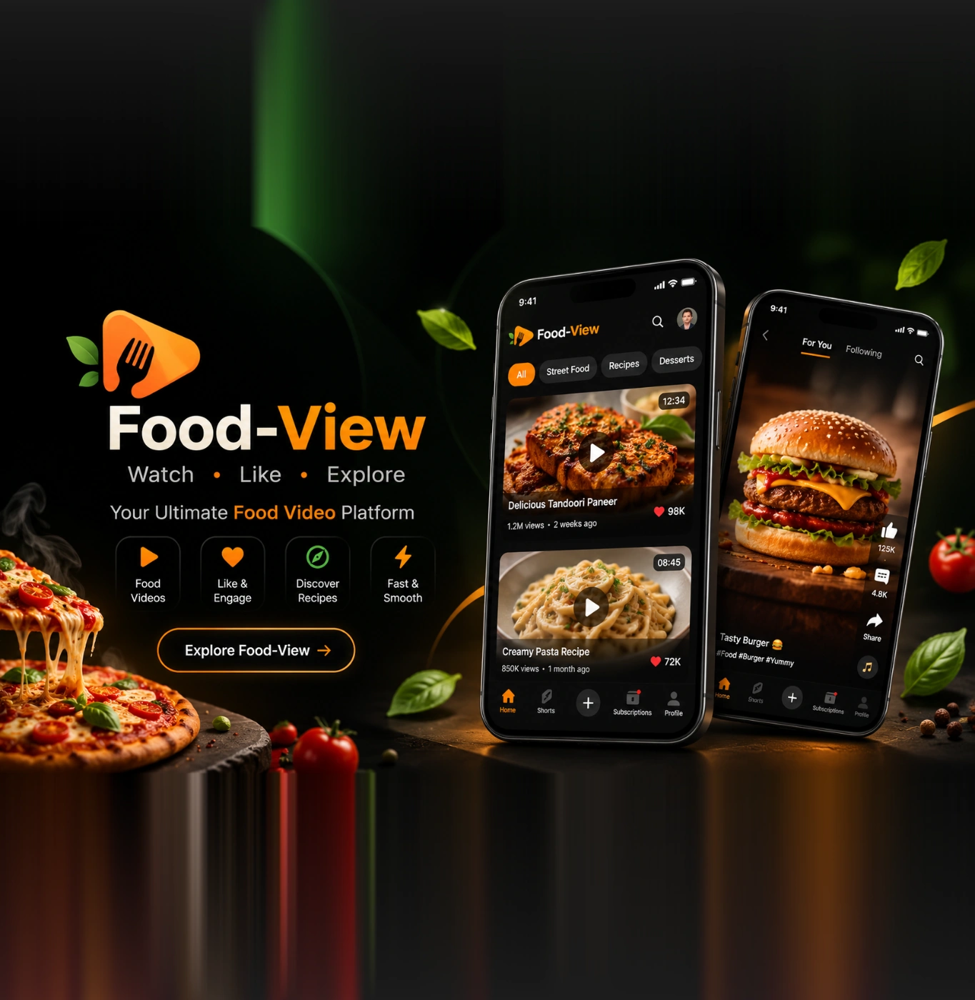
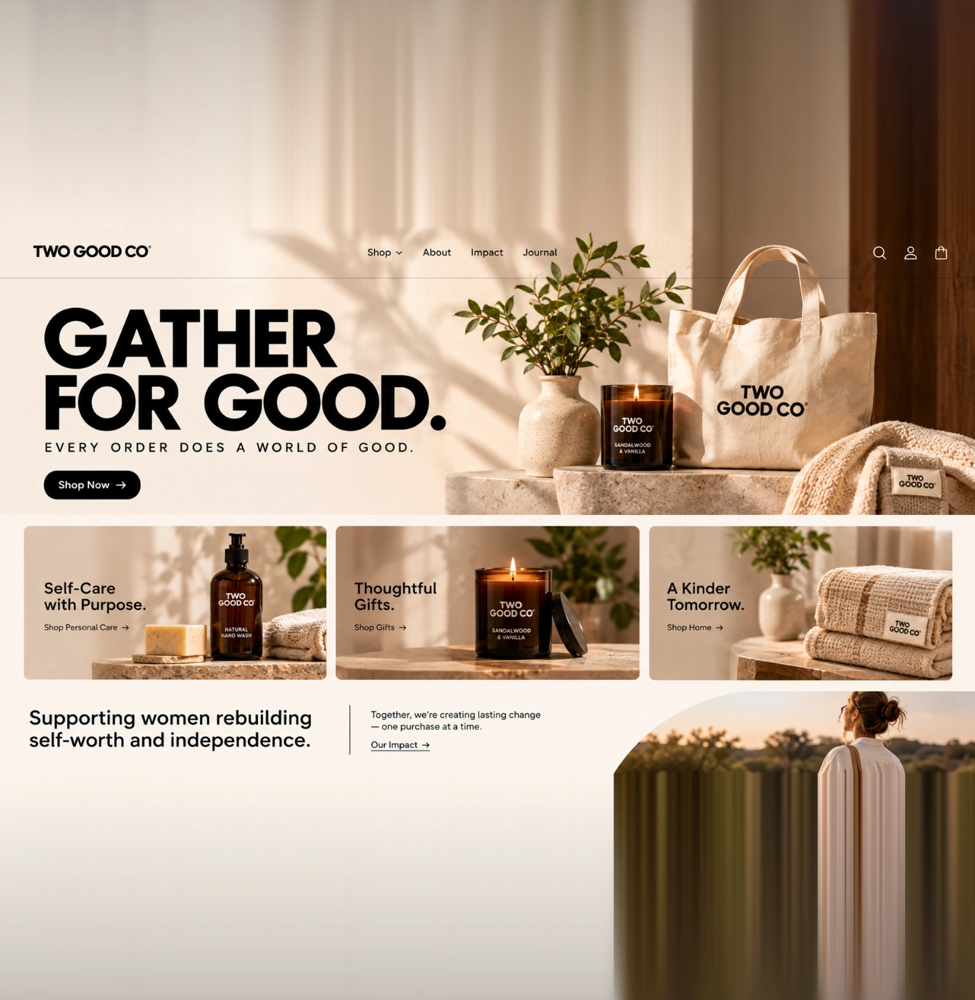

<div align="center">
  

  <p><strong>RAVI YADAV</strong> &nbsp; / &nbsp; PORTFOLIO</p>

  <h1>Thoughtful ideas.<br />Carefully built.</h1>

  <p>
    Computer Science student exploring full-stack development,<br />
    expressive interfaces, and the systems that make them work.
  </p>

  <p>
    <a href="#selected-work">SELECTED WORK</a>
    &nbsp; · &nbsp;
    <a href="#approach">APPROACH</a>
    &nbsp; · &nbsp;
    <a href="#technology">TECHNOLOGY</a>
    &nbsp; · &nbsp;
    <a href="#contact">CONTACT</a>
  </p>

  <br />

  

  <p><sub>DESIGN IN THE DETAILS. ENGINEERING UNDER THE SURFACE.</sub></p>
</div>

---

## 01 &nbsp; / &nbsp; The practice

I’m Ravi Yadav, a third-year Computer Science student interested in how ideas become useful, considered digital experiences.

I enjoy working across the full stack: shaping an interface, connecting it to the systems behind it, and understanding how the pieces fit together. I’m drawn to projects where visual character and technical problem-solving meet.

My process starts with understanding the problem. I break complex work into smaller parts, explore possible approaches, and keep learning as I build.

## 02 &nbsp; / &nbsp; Selected work

A selection of interface studies, full-stack applications, and backend projects.

<table>
  <tr>
    <td width="50%" valign="top">
      
      <p><sub>01 &nbsp; / &nbsp; BACKEND ENGINEERING</sub></p>
      <h3>LedgerGuard</h3>
      <p>A ledger-first banking API and operator dashboard for account management, double-entry postings, idempotent transfers, risk review, and reconciliation.</p>
      <a href="https://ledgerguard-frontend-q1se.onrender.com">PREVIEW ↗</a>
    </td>
    <td width="50%" valign="top">
      
      <p><sub>02 &nbsp; / &nbsp; INTERACTION STUDY</sub></p>
      <h3>Dogstudio</h3>
      <p>An interactive studio portfolio concept centered on a 3D dog that responds to hover, scrolling, and navigation.</p>
      <a href="https://github.com/RAVIKNR/Dogstudio">SOURCE ↗</a>
    </td>
  </tr>
  <tr>
    <td width="50%" valign="top">
      
      <p><sub>03 &nbsp; / &nbsp; WEB EXPERIENCE</sub></p>
      <h3>Food-View</h3>
      <p>A short-video food discovery app where diners browse, like, and save dish clips, while food partners can publish videos and store details.</p>
      <a href="https://github.com/RAVIKNR/Food-View">SOURCE ↗</a>
    </td>
    <td width="50%" valign="top">
      
      <p><sub>04 &nbsp; / &nbsp; INTERACTION STUDY</sub></p>
      <h3>Two Good Co.</h3>
      <p>An editorial storefront study bringing together product browsing, image-led sections, and the brand’s social-impact story.</p>
      <a href="https://github.com/RAVIKNR/TWO-GOOD-CO">SOURCE ↗</a>
    </td>
  </tr>
</table>

### More work

- **K72 Clone** — Responsive recreation of an agency website, focused on its visual identity, layouts, navigation, and motion. [Preview ↗](https://k72-clone-ppwj.onrender.com)
- **Backend Ledger** — Express and MongoDB banking API for account access, transfers, and transaction history. [Source ↗](https://github.com/RAVIKNR/Backend-Ledger)
- **Lazarev Design** — Front-end study of an AI-focused agency site, with animated navigation and project previews. [Source ↗](https://github.com/RAVIKNR/LAZAREV)
- **DSA Learning** — C++ LeetCode practice collection organized by topic, from arrays and linked lists to graphs and dynamic programming. [Source ↗](https://github.com/RAVIKNR/DSA)

## 03 &nbsp; / &nbsp; Technology

The tools and technologies represented across my work and portfolio.

| FRONTEND | BACKEND & DATA | TOOLS |
| --- | --- | --- |
| HTML · CSS · JavaScript · TypeScript · React · Tailwind CSS · GSAP · Three.js | C++ · Python · Node.js · Express · BullMQ · MongoDB · PostgreSQL · Redis | GitHub · VS Code · Docker · Render · Vite · Jest |

### Portfolio build

This portfolio is built with React, TypeScript, and Vite, with GSAP and Three.js among its interface and graphics libraries.

The contact form connects to a separate Node.js API. See [`backend/README.md`](backend/README.md) for its setup and deployment details.

## 04 &nbsp; / &nbsp; Currently exploring

I’m exploring generative AI and emerging technologies, and looking for thoughtful ways to apply them while building useful, reliable applications.

## 05 &nbsp; / &nbsp; Run locally

Start the portfolio frontend with Node.js and Vite:

```bash
npm install
npm run dev
```

Build the frontend or run the linter:

```bash
npm run build
npm run lint
```

To run the contact API locally, use Node.js 20.6 or newer and configure its environment variables as described in [`backend/README.md`](backend/README.md):

```bash
cd backend
npm start
```

## 06 &nbsp; / &nbsp; Contact

For questions, collaboration, or a conversation about the work:

**[GitHub · RAVIKNR ↗](https://github.com/RAVIKNR)**

---

<div align="center">
  <sub>THINK. LEARN. BUILD. EVOLVE.</sub>
</div>
